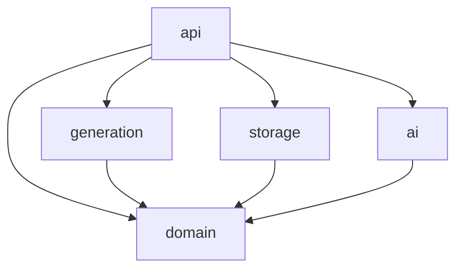

# Architecture overview

## Backend crates

| Crate | Responsibility |
| --- | --- |
| `domain` | Entities, validation, expression language, and the threat-model rules (crossings, risk levels, STRIDE suggestions, test templates). No I/O. |
| `generation` | Coverage-based test generation |
| `storage` | PostgreSQL persistence (sqlx) and migrations |
| `ai` | Provider trait, prompts, response validation, including the threat-model assistant (`tm`) |
| `api` | axum HTTP server, DTOs, wiring, config |

## Frontend
Angular app: `core` (API client, auth/config), `shared` (UI kit), `features/{explorer,models,test-cases,test-results,coverage,traceability,threat-model,proposals,settings}`.

## Cross-cutting
- Config via environment (`TM_` prefix) and optional config file.
- Logging/tracing via `tracing`.
- Migrations in `backend/crates/storage/migrations`.
