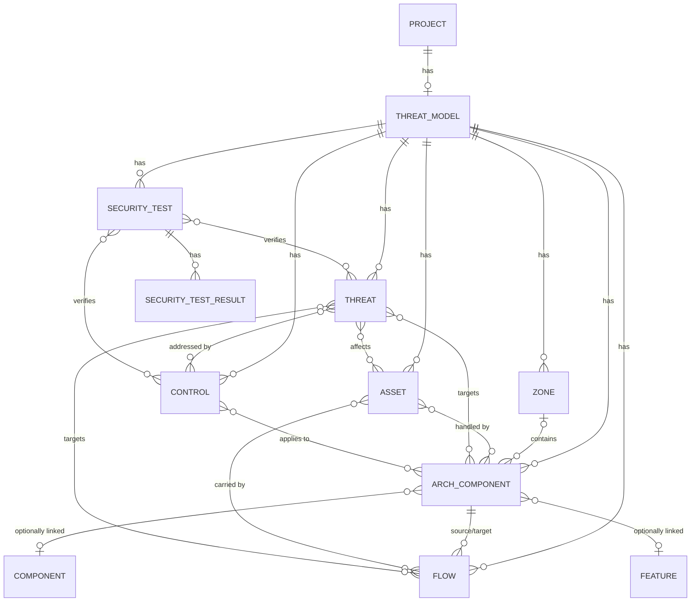

# Threat modeling

Each project can have one **threat model**: the architecture being built, what can go wrong with it, how serious that is, what is done about it, and security tests that check it. It answers five questions:

1. What are we building? — architecture components, data flows, exposure zones, assets.
2. What can go wrong? — threats (STRIDE), manual or suggested by rules.
3. How serious is it? — likelihood × impact, inherent and current.
4. What do we do about it? — treatment and security controls.
5. Did it work? — security tests and their results.

A **threat** is a potential attack scenario; its **risk** is the likelihood and impact of that scenario; a **control** is a measure that prevents, detects or corrects it. They are separate records.

Requirements: FR-060 to FR-076 in [03-requirements.md](03-requirements.md). API: tag `ThreatModel` in [openapi.yaml](openapi.yaml). Decision: [ADR 0011](../adr/0011-threat-model-entities-and-security-tests.md).

## Entities

All entities carry `id`, `version`, `createdAt`, `updatedAt`. Names of zones, architecture components and assets are unique within a threat model. Threats, controls and security tests have display ids `THR-n`, `CTL-n`, `SEC-n`, numbered per threat model and never reused.

- **Threat model**: one per project; `name`, `scope`, `objectives`, `assumptions`, `exclusions` (markdown), risk `thresholds`, diagram `layout` (opaque, own `layoutVersion`). Deleting the project deletes it and everything in it.
- **Exposure zone**: `kind` (internet, partner, dmz, internal, restricted-data, management, identity, cicd, third-party, other), `trustLevel` 0 (untrusted) … 4 (most trusted). Deleting a zone leaves its components without a zone.
- **Architecture component**: `type` (taxonomy below), `owner`, `technology`, `criticality` (low…critical), `internetFacing`, `zoneId?`, `linkedComponentId?` / `linkedFeatureId?` (same project; cleared when that Component/Feature is deleted), `assetIds`. Deleting it deletes the flows that start or end at it. Not the same thing as a project's *Component* (see the glossary).
- **Asset**: `category`, `owner`, `confidentiality` / `integrity` / `availability` (low, medium, high), `personalData`. Independent of components; linked to any number of components and flows.
- **Data flow**: `sourceId`, `targetId` (components of the same threat model), `relationship`, `label`, `protocol`, `bidirectional`, `authentication` (`none`, `unknown` — the default — or a free-text method), `encrypted` (yes, no, unknown), `assetIds`. Several flows may join the same pair.
- **Threat**: `title`, STRIDE `category`, `scenario`, `attackerObjective`, `preconditions`, `consequences`, `targets` (≥ 1 component or flow), `assetIds`, `controlIds`, `status`, `origin` (manual, rule), risk fields (below), and for rule threats an `explanation`.
- **Security control**: `type` (preventive, detective, corrective, compensating), `category` (identity-access, data-protection, application-network, detection-response, secure-development), `status` (planned, implemented, verified; `verifiedAt` is set when it becomes verified), `owner`, `acceptanceCriteria`, `componentIds`, `threatIds`.
- **Security test**: `title`, `objective`, `preconditions[]`, `steps[]` (action, expected), `type`, `status` (draft, ready, obsolete), `origin` (manual, generated), `threatIds` (≥ 1 on input), `controlIds`, and for generated tests the template id and version. Results: `outcome` (passed, failed, not-run), `note`, `executedAt`.

### Component type taxonomy

| Layer | Types |
| --- | --- |
| client | web-frontend, mobile-app, desktop-client, browser-extension |
| integration | api-gateway, api, message-broker, webhook, external-connector |
| logic | service, worker, scheduler, serverless-function |
| data | relational-database, object-storage, cache, search-index, file-store, backup |
| identity-security | identity-provider, authorization-service, secrets-manager, key-management, audit-service |
| platform | cloud-service, container-platform, cicd-pipeline, third-party-saas, library |
| external | human-user, external-system |

### Flow relationships
calls, sends-data, reads-writes, authenticates-through, trusts, depends-on, runs-on, publishes-subscribes, replicates-backs-up, deploys.

## Computed on read

Nothing below is stored or accepted as input; it is derived from the threat model each time it is read.

### Trust-boundary crossing
A flow crosses a trust boundary when

- both endpoints have a zone, the zones differ and their trust levels differ, or
- exactly one endpoint has a zone.

Two different zones with the same trust level are not a crossing; nor are two components without a zone. `direction` is `into-more-trusted` when the target's trust level is higher than the source's, `into-less-trusted` when lower; a component without a zone counts as trust level 0 for the direction. `fromTrust` / `toTrust` are the endpoints' levels (null without a zone).

### Warnings
| Code | On | When | Message |
| --- | --- | --- | --- |
| `NO_ZONE` | component | it has no zone | no exposure zone assigned |
| `NO_OWNER` | component | owner is empty | no owner |
| `INTERNET_FACING_NO_FLOW` | component | internet-facing and no flow starts or ends at it | internet-facing but no data flow documented |
| `CROSSING_AUTH_UNDOCUMENTED` | flow | crosses a boundary and authentication is `unknown` | authentication not documented |
| `CROSSING_ENCRYPTION_UNDOCUMENTED` | flow | crosses a boundary and encryption is `unknown` | encryption in transit not documented |
| `ASSET_UNLINKED` | asset | linked to no component and no flow | not linked to any component or flow |

### Risk score and level
A rating is a likelihood (1 rare, 2 unlikely, 3 possible, 4 likely, 5 almost certain) and an impact (1 negligible, 2 minor, 3 moderate, 4 major, 5 severe); its score is likelihood × impact. Each threat has an optional **inherent** rating (before controls) and an optional **current** rating (with the controls that exist). A missing rating is "not assessed", never a default.

Thresholds map scores to levels; the default is Low 1–4, Moderate 5–9, High 10–16, Critical 17–25. A threshold set must contain each of the four levels once, in ascending order, covering 1–25 without a gap or overlap; anything else is rejected with `422`. A change reclassifies every threat at once.

**No automatic reduction.** The current rating is the analyst's judgement. Linking a control or changing its status never changes a rating.

### Threat flags
| Flag | When |
| --- | --- |
| `no-control` | status open and no linked control |
| `planned-controls-only` | status open, at least one linked control, all of them planned |
| `unsupported-reduction` | both ratings set, current score below inherent score, and no linked control is implemented or verified |
| `overdue` | status open and the due date is before today (UTC) |
| `failing-test` | a linked security test's latest result is failed |

### Stale generated tests
A generated test is stale, with the first matching reason, when

1. it links no threat any more — `no threat`;
2. the threat it was generated for is dismissed — `threat dismissed`;
3. the control it was generated for is no longer linked to that threat (or was deleted) — `control unlinked: CTL-n` (or `control unlinked` if the control is gone).

Stale tests are never changed or deleted automatically. Manual tests are never stale.

## Threat lifecycle

`candidate → open → mitigated | accepted | dismissed`, with these rules (violations are `422`):

- Only rules create candidates; a manual threat starts open. A threat cannot return to candidate.
- `dismissed` requires a non-empty `dismissReason`.
- `accepted` requires treatment `accept`; setting treatment `accept` requires `acceptanceRationale` and `acceptedBy` and sets the status to accepted. Changing the treatment away from `accept` returns an accepted threat to open.
- Treatment: undecided (default), mitigate, avoid, transfer, accept; plus `riskOwner` and optional `dueDate`.

## STRIDE rules (ruleset version 1)

`POST /threat-models/{id}/threats/suggest` applies every rule to the current architecture. Each match has a **rule key** `<ruleId>:<component|flow>:<targetId>`. A match whose key was ever used in this threat model is skipped — including when its threat was dismissed or deleted — so a rule suggests a threat for a target at most once. New matches become **candidates** (status candidate, origin rule); they are not open threats and are not counted as such until a user confirms them.

Every candidate records an explanation: rule id, version and name, the **facts** that matched, the **missing information** that would confirm or dismiss it, the **recommended controls**, and the reminder that a control not being documented is a question to check, not a finding.

| Rule | Category | Target | Matches when | Missing information | Recommended controls |
| --- | --- | --- | --- | --- | --- |
| `SPOOF-BOUNDARY-AUTH` | spoofing | flow | crosses into a more trusted zone and authentication is `none` or `unknown` | document the authentication method to confirm or dismiss | service authentication; authorization at the receiving component |
| `INFO-BOUNDARY-ENCRYPTION` | information-disclosure | flow | crosses a boundary, encryption is `no` or `unknown`, and a linked asset has high confidentiality | document encryption in transit to confirm or dismiss | encryption in transit (TLS); message-level encryption for sensitive fields |
| `INFO-PUBLIC-SENSITIVE` | information-disclosure | component | internet-facing and a linked asset has high confidentiality | document the authorization policy to confirm or dismiss | object-level authorization; tenant isolation; access logging and alerting |
| `TAMPER-DATASTORE` | tampering | component | in the data layer and a linked asset has high integrity | document write access and integrity protection to confirm or dismiss | least-privilege write access; integrity checks; protected backups |
| `SPOOF-IDP` | spoofing | component | type identity-provider and the target of `authenticates-through` flows from two or more components | document how the identity provider is protected to confirm or dismiss | MFA for administrators; signing-key rotation; monitoring of authentication anomalies |
| `TAMPER-CICD` | tampering | component | type cicd-pipeline and the source of a `deploys` flow | document build integrity and deployment approvals to confirm or dismiss | signed build artifacts; protected branches and deployment approvals; secret scanning |
| `DOS-PUBLIC` | denial-of-service | component | internet-facing | document rate limits and capacity to confirm or dismiss | rate limiting and quotas; CDN or WAF in front |
| `REPUD-AUDIT` | repudiation | component | criticality high or critical and no `sends-data` flow from it to an audit-service component | document audit logging to confirm or dismiss | audit logging of security-relevant actions |

Facts name entities and attribute values, e.g. "Web app (Internet, trust 0) → Customer API (Internal, trust 3)", "authentication: unknown", "asset Customer records: confidentiality high", "dependants: Web app, Admin portal".

## Security test generation (template version 1)

`POST /threat-models/{id}/security-tests/generate` generates drafts for the given threats, or for every open and accepted threat when none is given; candidates, mitigated and dismissed threats are skipped. A template is chosen by the threat's category and the kind of its first target. Every template is control-specific: a threat with linked controls gets one test per control, a threat without controls gets one test. A test's **template key** is `<templateId>|<threatId>|<controlId or ->`; a key that already belongs to a non-obsolete test is skipped and counted. Generation never changes or deletes existing tests. Generated tests are drafts until a user marks them ready.

| Template | Category / target | Type | Steps (action → expected) |
| --- | --- | --- | --- |
| `AUTH-FLOW` | spoofing / flow | authentication | Call *target* from *source* without credentials → request is rejected; call with invalid or expired credentials → request is rejected; call with valid credentials → request is accepted |
| `AUTH-COMPONENT` | spoofing / component | authentication | Access *target* without credentials → access is denied; access with another identity's credentials → access is denied |
| `INTEGRITY-FLOW` | tampering / flow | transport-security | Modify a message from *source* to *target* in transit → *target* rejects it; replay a captured message → *target* rejects it |
| `INTEGRITY-COMPONENT` | tampering / component | negative-authorization | Modify *asset* in *target* without write permission → change is denied; make a permitted change → change is recorded with its author |
| `AUDIT` | repudiation / any | logging-audit | Perform a security-relevant action on *target* → an audit record with actor, time and action exists; as that actor, try to change or delete the record → change is denied |
| `TRANSPORT-FLOW` | information-disclosure / flow | transport-security | Observe traffic from *source* to *target* → payload is encrypted; connect without encryption → connection is refused |
| `ACCESS-COMPONENT` | information-disclosure / component | negative-authorization | As user A, request *asset* belonging to user B from *target* → access is denied; inspect the response → it contains none of user B's data |
| `RATE-LIMIT` | denial-of-service / any | resilience | Send requests to *target* above the documented rate limit → excess requests are throttled; meanwhile send a normal request as another client → it succeeds |
| `PRIVILEGE` | elevation-of-privilege / any | negative-authorization | As a low-privilege user, call an administrative operation of *target* → it is denied; try to change your own role → it is denied |

*target*/*source* are component names, *asset* the first linked asset (or "protected data"). When the test is for a control, a final step is added: "Verify control CTL-n *name*" → its acceptance criteria (or "the control is in place"). The title is "*template title*: *threat title*" plus " (CTL-n)" when per control; preconditions name the threat ("Threat THR-n is in scope").

## Security tests are a separate list

Security tests belong to the threat model. They are not feature test cases: they do not appear on the Test Cases page, in coverage, traceability, the project export, or test result import. Results are recorded by hand. CSV and Gherkin export of the filtered list happen in the browser; each Gherkin scenario is tagged `@sec-<id>` and with its threats' display ids (`@THR-1`), has one `Given` per precondition and a `When`/`Then` per step.
